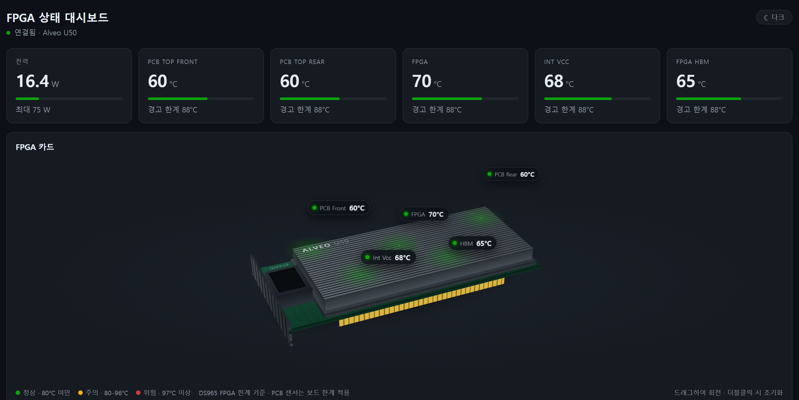
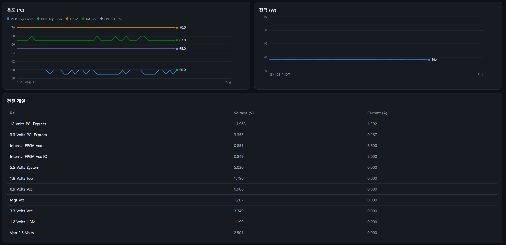

# ISC Monitoring Dashboard

FPGA 가속기의 상태를 웹 브라우저에서 실시간으로 확인하기 위한 경량 모니터링 대시보드입니다. 현재 백엔드는 XRT의 `xrt-smi`를 통해 장치와 센서 정보를 수집하며, FastAPI와 WebSocket을 사용해 온도 및 전력 상태를 화면에 전달합니다.

## 주요 기능

- 시스템에 연결된 FPGA 가속기 자동 검색
- 온도와 전력 사용량 실시간 모니터링
- 개별 전원 레일의 전압 및 전류 확인
- 온도 변화와 전력 사용량을 시계열 차트로 표시
- 온도 수준에 따른 주의, 경고, 위험 및 치명 상태 알림
- FPGA 카드의 센서 위치와 상태 시각화
- WebSocket 연결 종료 시 자동 재연결
- 시스템 설정을 따르는 라이트 및 다크 테마
- 온도 경고 단계 변경 이력을 애플리케이션 로그에 기록

## 대시보드 화면

### 장치 상태 및 FPGA 카드

<p align="center">
  
</p>

### 온도·전력 차트 및 전원 레일

<p align="center">
  
</p>

## 시스템 구성

```text
웹 브라우저
    │  HTTP / WebSocket
    ▼
FastAPI 백엔드
    │  xrt-smi examine
    ▼
FPGA 가속기 및 센서
```

백엔드는 장치 목록과 센서 데이터를 조회하고, 프런트엔드는 1초 간격의 WebSocket 스트림을 받아 온도, 전력, 전원 레일 및 경고 상태를 갱신합니다.

## 요구 사항

- Linux
- Python 3.9 이상
- FastAPI
- Uvicorn
- XRT 및 `xrt-smi`를 지원하는 FPGA 가속기

현재 구현은 다음 경로의 `xrt-smi`를 사용합니다.

```text
/opt/xilinx/xrt/bin/xrt-smi
```

다른 경로에 XRT가 설치되어 있다면 `backend/xrt_source.py`의 `XRT_SMI` 값을 환경에 맞게 변경해야 합니다.

## 설치 및 실행

저장소를 복제하고 Python 가상환경을 준비합니다.

```bash
git clone https://github.com/Adv-FileSystem/ISC_Monitoring_Dashboard.git
cd ISC_Monitoring_Dashboard

python3 -m venv .venv
source .venv/bin/activate
pip install fastapi uvicorn
```

백엔드 디렉터리에서 서버를 실행합니다.

```bash
cd backend
uvicorn main:app --host 0.0.0.0 --port 8811
```

웹 브라우저에서 다음 주소로 접속합니다.

```text
http://localhost:8811
```

다른 장치에서 접속하려면 `localhost` 대신 대시보드를 실행하는 서버의 IP 주소를 사용합니다.

## API

| 경로 | 방식 | 설명 |
| --- | --- | --- |
| `/api/devices` | GET | 연결된 FPGA 가속기 목록 조회 |
| `/api/sensors/{bdf}` | GET | 지정한 BDF 장치의 센서 상태 조회 |
| `/ws/{bdf}` | WebSocket | 지정한 장치의 실시간 센서 데이터 수신 |

## 저장소 구조

```text
.
├── backend/
│   ├── main.py          # FastAPI 서버와 WebSocket 스트림
│   └── xrt_source.py    # xrt-smi 실행 및 센서 데이터 변환
├── docs/
│   └── images/          # README용 대시보드 이미지
├── frontend/
│   └── index.html       # 대시보드 화면
└── README.md
```

## 운영 시 참고 사항

- 현재 온도 임계값은 Alveo U50 기준으로 정의되어 있습니다. 다른 장치를 사용할 때는 해당 장치의 데이터시트를 기준으로 값을 검토해야 합니다.
- 서버는 기본 실행 예시에서 모든 네트워크 인터페이스(`0.0.0.0`)에 바인딩됩니다.
- 별도의 사용자 인증 기능은 구현되어 있지 않으므로 신뢰할 수 있는 내부망에서 사용하거나 리버스 프록시의 인증 및 접근 제어와 함께 운영하는 것을 권장합니다.
